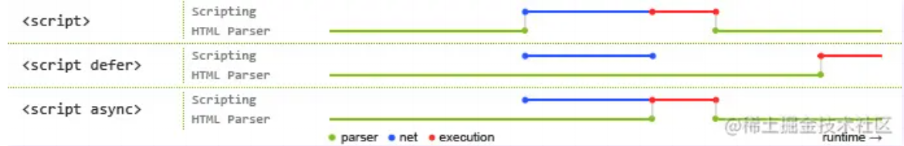

# HTML八股
## 学习链接 https://juejin.cn/post/6905294475539513352
### 考察很多
- `src`与`href`区别   
    - 资源引用 嵌入当前标签 下载 暂停其他过程  
    -  超文本引用 其他文件下载 不停止对当前文档的处理 `a` `link`
- HTML语义化理解  
    - 指的是用内容的结构选择合适标签 内容代码语义化  
    - 对机器友好 对开发者友好  
    - 头部 导航栏 区块 主要区域 主要内容 侧边栏 底部  
- script中defer和async区别  
    - 都异步不阻塞页面解析  
    - defer是脚本加载但文档加载完后再执行 async是加载了立马执行  
    - defer是加载后续文档的过程和js脚本的加载(此时仅加载不执行)是并行进行的(异步) async是后续文档的加载和执行与js脚本的加载和执行是并行进行的  
    - 多个defer 按顺序 多个async 顺序不确定  
    
- HTML5更新部分  
    - 语义化标签 媒体标签 表单 进度条度量器 dom查询 web存储..
- 行内元素 块级元素 空元素  
    - `a` `b` `span` `img` `input` `select` `strong`  
    - `div` `ul` `ol` `li` `dl` `dt` `dd` `h1~h6` `p`  
    - ` ` `
` `` `<input>` `<link>` `<meta>`  
### 考察较多  
- DOCTYPE的作用  
    - html5中的一种标准的文档类型说明 告诉浏览器文档类型再去解析xhtml或html  
    - 浏览器渲染页面两种模式  标准模式 怪异模式（页面较宽松的向后兼容）  
- 常用的meta标签  
    - meta标签=name+content属性 描述网页文档属性  
    - charset 编码类型  
    - keywords 页面关键词  
    - description 页面描述  
    - refresh 页面重定向 刷新  
    - viewport 适配移动端 视口大小和比例  
    - content参数 宽高 初始/最大/最小缩放比例 是否允许用户缩放  
    - 搜索引擎方式 content参数 all none index follow noindex nofollow  
- web worker  
    - 运行在后台的js 独立于其他脚本 不会影响html页面性能 通过postMessage传回结果 可进行复杂操作  
    - 创建：检测浏览器对其支持性 创建web worker文件 创建对象  
- head标签作用 其中说明标签必不可少  
    - 定义文档头部 所有头部元素的容器 下面这些标签可用在 head 部分：`<base>`, `<link>`, `<meta>`, `<script>`, `<style>`, `<title>`  
    - title元素必不可少  
- Canvas和SVG的区别  
    - Canvas：通过js 2d绘图 位置改变重新绘制；依赖分辨率 不支持事件处理器 文本渲染弱 能够保存png jpg图片 适合图像密集的游戏  
    - SVG：可缩放矢量图形 基于可拓展标记语言xml描述的2d图形语言 属性变化 浏览器自动重现；不依赖分辨率 支持事件处理器 适合大型渲染区域程序 复杂度高渲染变慢 不适合游戏应用  
- title与h1的区别 b与strong的区别 l与em的区别  
    - title属性没有明确意义 只是标题 h1表示层次明确的标题 对页面信息的抓取影响很大  
    - b只是简单加粗标签 strong有语义 加重语气  
    - i内容展示为斜体 em表示强调的文本  